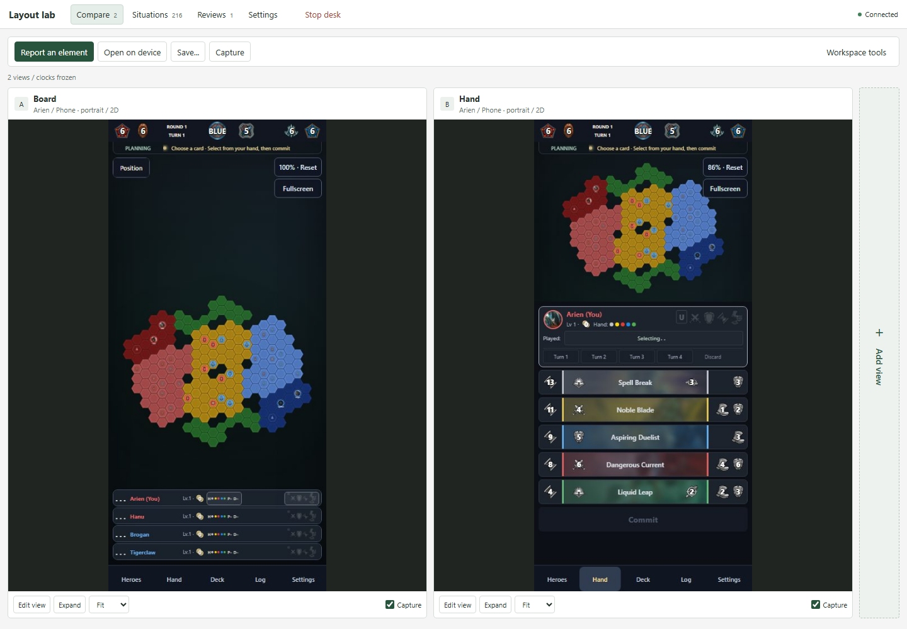
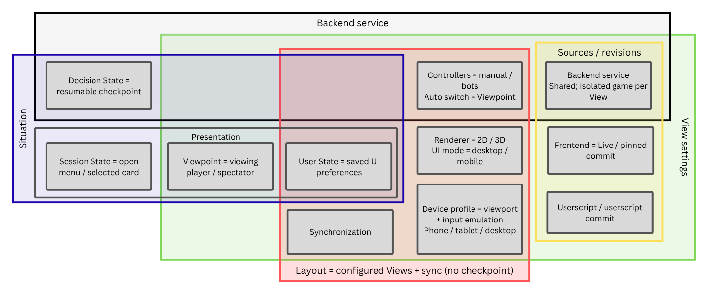

# GoA2 Layout Lab

**1.0-preview** · [Changelog](CHANGELOG.md)

A local workspace for comparing Guards of Atlantis II interfaces, reproducing
game moments, and collecting useful reports. Start with one View of your current
frontend, then add up to two more.



_Two independent phone Views in the browser desk, using the live frontend._

## What you can do

- Compare live edits, pinned frontend commits, and a userscript reference in 2D or 3D.
- Save reproducible Situations, including the viewing player, open panels, selected cards, and supported preferences.
- Open a Situation on a physical device using a link or QR code, and play against Random, Simple, or ISMCTS bots.
- Inspect a queue of Situations, report elements across Views, and collect screenshots, HTML/CSS, comments, and revision evidence.

## Start

Keep the frontend and backend checkouts alongside this repository:

```text
GitHub/
  goa2-layout-lab/
  goa2-frontend/
  goa2-backend/
  goa2-mobile-2d-patch/   # optional userscript comparison
```

Install Node.js 22.12+, Git, and uv. Windows also needs WSL with Node/npm/uv;
Linux and macOS run natively. Prepare the frontend's model assets with
`npm run models:prepare` if needed.

From this repository:

```sh
npm run compare
```

The launcher installs lab dependencies on first use and opens the native desk.
The desk is served at **http://localhost:3200**. Game services are isolated from
your regular development servers.

1. Press **Start**, choose a Situation, and keep or adjust the default Live View.
2. Use **Add view** to copy the current moment into another independent View.
3. Use **Save…** to save a Situation or Layout, **Report element** to flag a
   problem, or **Capture** to export images.
4. For a sequence, select Situations and press **Start review**. Previous/Next
   restores every View together; reports collect under that Run.

Use **Open on device** for the phone link and QR code. Use **Stop desk** or
`npm run compare -- --stop` to close the lab and its owned services.

See [setup and runtime](docs/setup.md) for platform requirements, checkout
overrides, launcher options, caching, and troubleshooting.

## How the pieces fit

[](docs/assets/decision-state.png)

[Editable diagram in Canva](https://www.canva.com/d/nJcSsJiK__TqhAK) ·
[Precise definitions and resolution rules](docs/terminology.md)

A **Situation** combines an exact **Decision State** with a **Presentation**
(Viewpoint, Session State, and User State). A **View** runs an independent copy.
A **Layout** keeps View settings and synchronization separate from the saved
game moment. A **Review Run** freezes a queue of Situations and collects its
reports.

## Guides

| Task                                                     | Guide                                                                           |
| -------------------------------------------------------- | ------------------------------------------------------------------------------- |
| Install, configure, or troubleshoot                      | [Setup and runtime](docs/setup.md)                                              |
| Choose sources, arrange Views, save moments, synchronize | [Workspace](docs/workspace.md)                                                  |
| Export screenshots, crops, diffs, or HTML/CSS            | [Captures and source inspection](docs/captures.md)                              |
| Test on a phone or play against bots                     | [Devices and bots](docs/device-testing.md)                                      |
| Report an element across Views                           | [Element reports](docs/element-reporting.md)                                    |
| Inspect queues and rerun earlier reviews                 | [Reviews and evidence](docs/reviews.md)                                         |
| Understand saved state or port old Situations            | [Terminology](docs/terminology.md) · [Storage and porting](docs/state-model.md) |
| Browse the shared fixtures                               | [Situation library](situations/README.md)                                       |

## Development

```sh
npm test
```

See [testing](docs/testing.md) for browser/native acceptance checks,
[AGENTS.md](AGENTS.md) for repository skills, and
[plans](docs/plans/README.md) for design records and remaining work.

This is the first tracked preview release. See the [changelog](CHANGELOG.md)
for its scope and [release workflow](docs/releases.md) for versioning.
